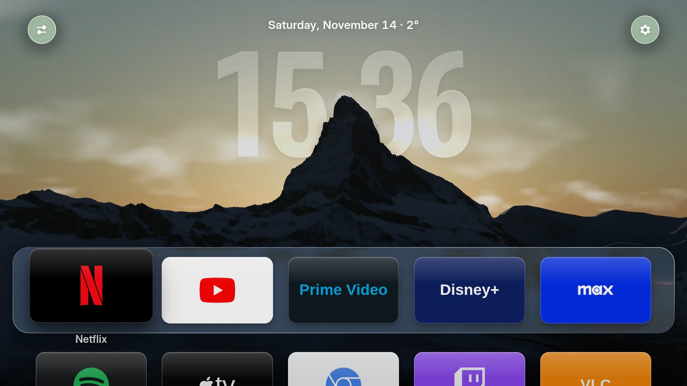
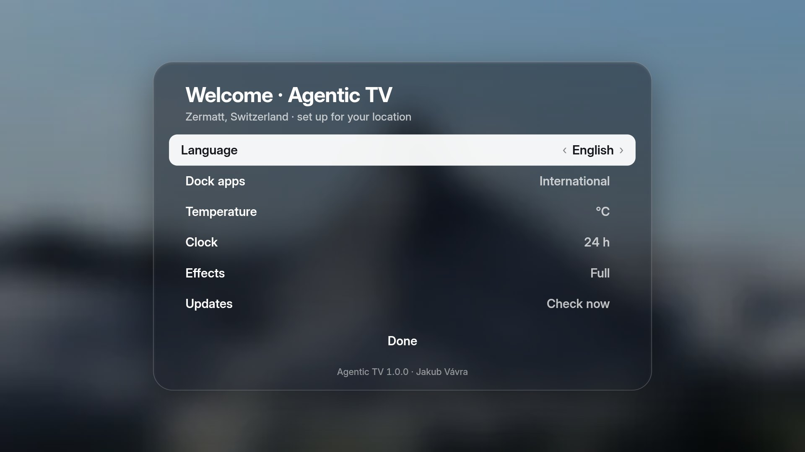
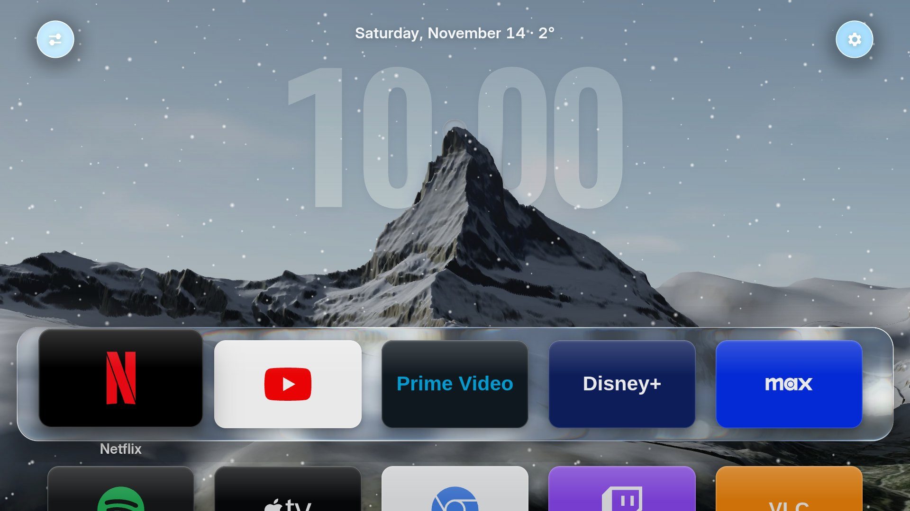

<p align="center">
  
</p>

<h1 align="center">Agentic TV</h1>

<p align="center">
  <b>A calm, glassy home screen for Android TV, made by Jakub Vávra.</b><br>
  Live weather in the landscape · 8 languages · voice commands · updates itself from GitHub
</p>

<p align="center">
  <a href="https://github.com/jakubvavradev/agentic-tv/releases/latest"><b>⬇ Download the APK</b></a> ·
  <a href="docs/INSTALL.md">Install guide</a> ·
  <a href="docs/INSTALL.cs.md">Návod česky</a> ·
  <a href="docs/media/agentic-tv-16x9.mp4">Watch the video</a>
</p>

---

## What it is

Agentic TV replaces the stock launcher on an Android TV box or TV with one quiet screen: a mountain
that follows the real sun where you live, a clock made of glass, and your apps on a shelf.
It is the first piece of a bigger idea: a TV you can simply ask for things.

| | |
|---|---|
| **The landscape is the weather** | Rain, snow, fog and cloud appear *in* the scene, from [Open-Meteo](https://open-meteo.com) for your location. Sunrise, day, golden hour and night follow the real sun, for every month of the year. |
| **Works anywhere, set up in one minute** | On first start it finds your country (from your IP, no permission needed) and suggests the language, °C/°F, 12/24 h and the apps for the dock. A sheet comes up once, you press *Done*. |
| **Preferences, top left** | Language, dock apps, temperature, clock, effects (*Light* for slower boxes) and *Check for updates*. System settings stay top right. |
| **Updates from GitHub** | Once a day it checks this repo's releases. A red dot on Preferences means a new version; one click downloads it and Android asks you to confirm. |
| **Voice** | Press the remote's mic button: *“otevři Netflix”*, *“pusť Wednesday na Netflixu”*. Czech has its own command grammar; other languages go to Google Assistant. |
| **Your order** | Hold OK on any app to pick it up and move it; the first five sit on the glass shelf. |

<p align="center">
  
  
</p>

Languages: Čeština · Slovenčina · English · Deutsch · Polski · Français · Español · Italiano.

## Install

Short version (full guide with pictures: [docs/INSTALL.md](docs/INSTALL.md)):

1. Download `agentic-tv-<version>.apk` from [Releases](https://github.com/jakubvavradev/agentic-tv/releases/latest)
   onto the TV (the *Downloader* app works, or `adb install`).
2. Make it the home screen. On Android TV 12+ the stock launcher has to be switched off once over ADB:
   ```sh
   adb install agentic-tv-1.0.0.apk
   adb shell cmd package set-home-activity cz.vavra.home/.MainActivity
   adb shell pm disable-user --user 0 com.google.android.tvlauncher   # Google TV: com.google.android.apps.tv.launcherx
   ```
3. Press Home. The welcome sheet comes up; check the language and press *Done*.

Going back to the original launcher is one line: `adb shell pm enable com.google.android.tvlauncher`.

Requirements: Android TV / Google TV 7.0 or newer, internet for weather and location (the screen works offline too).

## Privacy

No account, no analytics, no tracking. The TV talks to exactly three public services:
your approximate location from your IP ([geojs.io](https://www.geojs.io), fallback [ipwho.is](https://ipwho.is)),
weather for that spot ([Open-Meteo](https://open-meteo.com)), and this repo's
[releases](https://docs.github.com/en/rest/releases) for updates. The optional voice service only watches
Google Assistant's own window, and only to hand your command to it.

## Build it yourself

No Gradle, just the Android SDK build tools (35) and a JDK:

```sh
android/build.sh          # -> android/build/home.apk
android/deploy.sh         # build, install on TV=<ip:5555>, make it Home, check it is in front
```

Preview on a computer without a TV: `cd android/assets && python3 -m http.server 8097`, open
`http://127.0.0.1:8097/?h=17.5&wx=snow`. Parameters: `h` = hour, `wx` = clear | cloud | fog | rain | snow, `amt` = 0..1.
Arrow keys and Enter act as the remote.

| Path | What |
|---|---|
| `android/assets/index.html` | the whole home screen (one page in a WebView) |
| `android/assets/lglass.js` | WebGL Liquid Glass for the clock, shelf and buttons |
| `android/src/…/MainActivity.java` | WebView host, app list and banners, voice, self-update |
| `android/src/…/KeyService.java` | optional: mic button → Agentic TV voice, commands typed into Google Assistant |
| `www/`, `tools/` | the 3D scene the wallpapers are rendered from, and the render scripts |

## Credits

Made by **Jakub Vávra** ([@jakubvavradev](https://github.com/jakubvavradev)).

Terrain and imagery © [swisstopo](https://www.swisstopo.admin.ch) (swissALTI3D, SWISSIMAGE) · AWS Terrain Tiles ·
Sentinel-2 cloudless 2016 © EOX (CC BY 4.0). Weather by [Open-Meteo](https://open-meteo.com) (CC BY 4.0).
Glass optics adapted from [ybouane/liquidglass](https://github.com/ybouane/liquidglass) (MIT) and
[rdev/liquid-glass-react](https://github.com/rdev/liquid-glass-react) (MIT).
Fonts: Inter and Roboto Flex (SIL OFL 1.1). Agent orb: [thinking-orbs](https://github.com/Jakubantalik/thinking-orbs) (MIT).
App names and logos in screenshots belong to their owners; the demo tiles exist only for the desktop preview.

## License

[MIT](LICENSE) for the code. Third-party data and fonts keep their own licenses (above).
