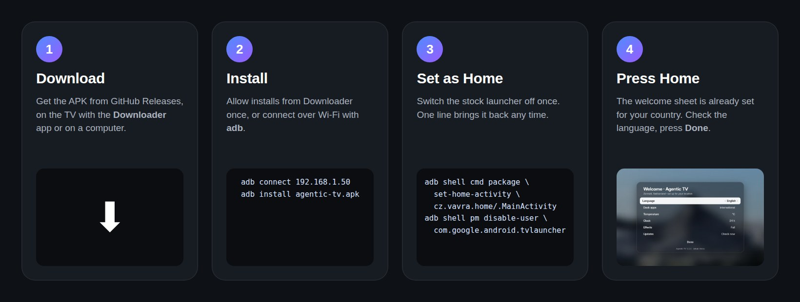

# Instalace Agentic TV

Zabere asi 10 minut a dělá se jednou. Potřebuješ televizi nebo Android TV box a pro krok 3 počítač na stejné Wi-Fi.

> Funguje na Android TV a Google TV 7.0 a novějších (Chromecast s Google TV, Nvidia Shield, Xiaomi Mi Box,
> Strong, televize Philips a Sony s Androidem…). Fire TV jako domovskou obrazovku nepodporuje.

<p align="center"></p>

## 1. Dostaň APK do televize

**Nejjednodušší: aplikace Downloader v televizi**

1. V televizi otevři Google Play a nainstaluj **Downloader** (od AFTVnews).
2. V Downloaderu zadej adresu `https://github.com/jakubvavradev/agentic-tv/releases/latest`
   a otevři soubor `agentic-tv-….apk`.
3. Android se zeptá, jestli povolit instalace z Downloaderu. Povol a dej **Instalovat**.

**Z počítače:** stáhni APK z [Releases](https://github.com/jakubvavradev/agentic-tv/releases/latest) a nainstaluj ho v kroku 3 příkazem `adb install`.

## 2. Zapni ladění po síti (jen kvůli kroku 3)

1. Otevři *Nastavení → Předvolby zařízení → Informace* a sedmkrát klikni na **Sestavení** (objeví se „Nyní jste vývojář“).
2. V *Nastavení → Předvolby zařízení → Pro vývojáře* zapni **Ladění USB**. Na některých boxech se to jmenuje *Síťové ladění* nebo *ADB*.
3. Zjisti IP adresu televize: *Nastavení → Síť a internet →* tvoje Wi-Fi.

## 3. Nastav Agentic TV jako domovskou obrazovku

Android TV nedovolí vybrat jinou domovskou obrazovku v menu, takže původní launcher je potřeba jednou vypnout.
Na počítač si nainstaluj [platform-tools](https://developer.android.com/tools/releases/platform-tools), které obsahují `adb`, a spusť:

```sh
adb connect 192.168.1.50:5555          # IP tvé televize; na TV potvrď „Povolit ladění“
adb install agentic-tv-1.0.0.apk       # vynech, pokud jsi instaloval přes Downloader
adb shell cmd package set-home-activity cz.vavra.home/.MainActivity
adb shell pm disable-user --user 0 com.google.android.tvlauncher
#   na zařízeních s Google TV místo toho:
#   adb shell pm disable-user --user 0 com.google.android.apps.tv.launcherx
```

Zmáčkni na ovladači **Domů** a naskočí Agentic TV.

## 4. První spuštění

Uvítací panel se otevře sám a je už nastavený podle toho, kde jsi:

| Řádek | Co dělá | Ovladač |
|---|---|---|
| Jazyk | 8 jazyků | ◀ ▶ |
| Aplikace v doku | *Česko* (Oneplay, Prima+, iVysílání…) nebo *Mezinárodní* (Netflix, YouTube, Prime Video, Disney+, Max…) | ◀ ▶ |
| Teplota | °C / °F | ◀ ▶ |
| Hodiny | 24 h / 12 h | ◀ ▶ |
| Efekty | *Plné* (sklo a padající déšť či sníh) nebo *Úsporné* pro slabší boxy | ◀ ▶ |
| Aktualizace | zkontroluje GitHub a nainstaluje novější verzi | OK |

Dej **Hotovo**. Kdykoli později se k panelu vrátíš šipkou **nahoru** z poličky, je to kulaté tlačítko vlevo nahoře.

## Běžné ovládání

- **◀ ▶** přesouvá po poličce, **▼** otevře všechny aplikace, **▲** vede na Předvolby (vlevo) a Nastavení (vpravo).
- **Podržením OK** aplikaci zvedneš a přesuneš, dalším OK ji pustíš. Prvních pět aplikací je na skleněné poličce.
- **Tlačítko mikrofonu**: *„otevři YouTube“*, *„pusť Wednesday na Netflixu“*, *„najdi Stranger Things na YouTube“*.
  Aby mikrofon otevíral hlasové ovládání Agentic TV místo Google Asistenta, zapni
  *Nastavení → Přístupnost → Agentic TV – hlasové ovládání* (nepovinné).

## Aktualizace

Agentic TV jednou denně zkontroluje vydání v tomhle repozitáři. Když vyjde nová verze, objeví se na tlačítku Předvolby
červená tečka. Otevři Předvolby → **Aktualizace → Nainstalovat**. Poprvé se Android zeptá, jestli povolit instalace
z Agentic TV, a příště už stačí jen potvrdit.

## Návrat k původnímu launcheru

```sh
adb shell pm enable com.google.android.tvlauncher      # nebo com.google.android.apps.tv.launcherx
adb uninstall cz.vavra.home                            # nepovinné: odebere Agentic TV
```

## Když něco nejde

| Problém | Řešení |
|---|---|
| Domů pořád otevírá starý launcher | Původní launcher je pořád zapnutý. Spusť řádek `pm disable-user` pro svoje zařízení (krok 3). |
| Chybí teplota nebo počasí | Televize nemá internet, nebo síťový filtr blokuje `get.geojs.io` / `api.open-meteo.com`. Zbytek funguje i offline. |
| Na starším boxu se to seká | Předvolby → Efekty → **Úsporné**. |
| Při aktualizaci hlášení „Aplikace nebyla nainstalována“ | Máš verzi podepsanou někým jiným (např. vlastní build). Jednou ji odinstaluj a pak nainstaluj APK z Releases. |
| Na poličce chybí aplikace | Zobrazují se jen aplikace nainstalované v televizi. Nainstaluj ji z Google Play, objeví se na konci a podržením OK ji přesuneš. |

Dotazy a nápady piš do [issues](https://github.com/jakubvavradev/agentic-tv/issues).
