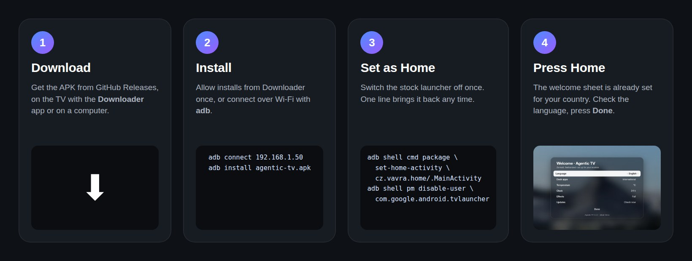

# Installing Agentic TV

About 10 minutes, once. You need the TV (or Android TV box) and, for step 3, a computer on the same Wi-Fi.

> Works on Android TV and Google TV 7.0 or newer (Chromecast with Google TV, Nvidia Shield, Xiaomi Mi Box,
> Strong, Philips/Sony Android TVs …). Fire TV is not supported as a home screen.

<p align="center"></p>

## 1. Get the APK onto the TV

**Easiest: the Downloader app on the TV**

1. On the TV, open Google Play and install **Downloader** (by AFTVnews).
2. In Downloader, type the address `https://github.com/jakubvavradev/agentic-tv/releases/latest`
   and open the `agentic-tv-….apk` file.
3. Android asks to *allow installs from Downloader* → allow → **Install**.

**From a computer:** download the APK from [Releases](https://github.com/jakubvavradev/agentic-tv/releases/latest) and use step 3 (`adb install`).

## 2. Turn on network debugging (only for step 3)

1. *Settings → Device Preferences → About* → click **Build** seven times (“You are now a developer”).
2. *Settings → Device Preferences → Developer options* → turn on **USB debugging**
   (on some boxes it is called *Network debugging* / *ADB debugging*).
3. Note the TV's IP address: *Settings → Network & Internet →* your Wi-Fi.

## 3. Make Agentic TV the home screen

Android TV does not let you pick a different home screen from the menu, so the stock launcher is switched off once.
On the computer install [platform-tools](https://developer.android.com/tools/releases/platform-tools) (gives you `adb`), then:

```sh
adb connect 192.168.1.50:5555          # your TV's IP; confirm "Allow debugging" on the TV
adb install agentic-tv-1.0.0.apk       # skip if you installed it with Downloader
adb shell cmd package set-home-activity cz.vavra.home/.MainActivity
adb shell pm disable-user --user 0 com.google.android.tvlauncher
#   Google TV devices use this one instead:
#   adb shell pm disable-user --user 0 com.google.android.apps.tv.launcherx
```

Press **Home** on the remote. Agentic TV comes up.

## 4. First start

The welcome sheet opens by itself, already set for where you are:

| Row | What it does | Remote |
|---|---|---|
| Language | 8 languages | ◀ ▶ |
| Dock apps | *Czechia* (Oneplay, Prima+, iVysílání …) or *International* (Netflix, YouTube, Prime Video, Disney+, Max …) | ◀ ▶ |
| Temperature | °C / °F | ◀ ▶ |
| Clock | 24 h / 12 h | ◀ ▶ |
| Effects | *Full* glass and falling rain/snow, or *Light* for slower boxes | ◀ ▶ |
| Updates | checks GitHub, installs a newer version | OK |

Press **Done**. You can open it again any time: **Up** from the shelf, the round button top left.

## Everyday use

- **◀ ▶** move along the shelf, **▼** opens all apps, **▲** reaches Preferences (left) and Settings (right).
- **Hold OK** on an app to move it; let go of it with OK. The first five apps sit on the shelf.
- **Mic button**: *“open YouTube”*, in Czech also *“pusť Wednesday na Netflixu”*.
  For the mic to open Agentic TV's voice instead of Google Assistant, turn on
  *Settings → Accessibility → Agentic TV – voice control* (optional).

## Updates

Once a day Agentic TV checks this repository's releases. When there is a newer version, the Preferences button
gets a red dot. Open Preferences → **Updates → Install**. The first time, Android asks you to allow installs
from Agentic TV; after that it is one confirmation.

## Going back to the original launcher

```sh
adb shell pm enable com.google.android.tvlauncher      # or com.google.android.apps.tv.launcherx
adb uninstall cz.vavra.home                            # optional: remove Agentic TV
```

## Troubleshooting

| Problem | Fix |
|---|---|
| Home still opens the old launcher | The stock launcher is still enabled. Run the `pm disable-user` line for your device (step 3). |
| No temperature or weather | The TV has no internet, or a network filter blocks `get.geojs.io` / `api.open-meteo.com`. The rest works offline. |
| It feels slow on an older box | Preferences → Effects → **Light**. |
| “App not installed” when updating | You installed a build signed by someone else (e.g. self-built). Uninstall it once, then install the release APK. |
| An app is missing on the shelf | Only apps installed on the TV appear. Install it from Google Play, it shows up at the end; hold OK to move it. |

Questions or ideas: [open an issue](https://github.com/jakubvavradev/agentic-tv/issues).
